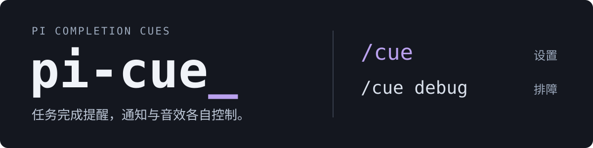
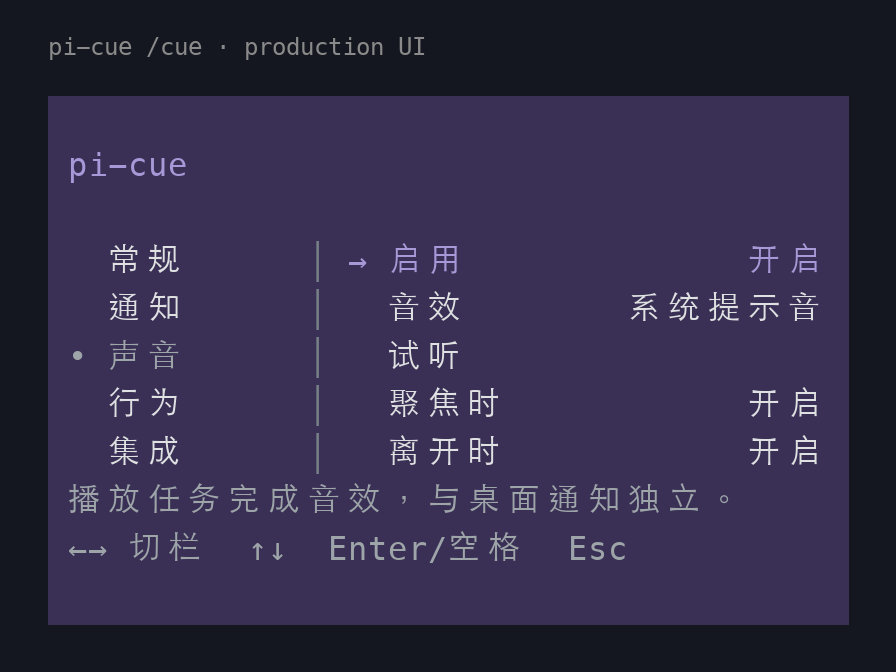

<p align="center">
  
</p>

# pi-cue

**English** · [简体中文](README.zh-CN.md)

**Completion cues for Pi.** Control desktop notifications and sounds independently, with timing that adapts to terminal focus. Get one cue when a round of work finishes, then return to what matters.

<p align="center">
  
</p>

<p align="center">
  <sub>Settings preview.</sub>
</p>

## Features

- **A cue when the whole round ends.** Retries and queued follow-up work stay in the same round; notification rules are checked once it finishes.
- **Separate notification and sound controls.** Desktop notifications request silent delivery. Enable, select, and preview sounds independently, with thresholds for task duration and time away.
- **Settings in Pi's native TUI.** English and Simplified Chinese, five everyday settings categories, and immediate saving when a change is confirmed. Troubleshooting lives in `/cue debug`.
- **Optional integration events.** Observe Ask prompts awaiting an answer and asynchronous subtask events through verified protocols. These integrations are off by default; read the [integration guide](docs/integrations.md) before enabling them.

## Quick start

Requires **Node.js 24+** and **Pi 1.4.0**. The current integration targets Pi TUI 1.4.0; pi-open-tui is not required.

Install [`@mikuhello/pi-cue`](https://www.npmjs.com/package/@mikuhello/pi-cue) and register the extension in your personal Pi settings:

```sh
pi install npm:@mikuhello/pi-cue
```

Start a new Pi session, then enter `/cue`. To try it for one session without registering it:

```sh
pi -e npm:@mikuhello/pi-cue
```

GitHub installation is also supported:

```sh
pi install git:github.com/MikuHello/pi-cue
```

### From a source checkout

Download or clone the source, then install dependencies from the project directory:

```sh
npm ci --ignore-scripts --cache .dev/npm-cache --no-audit --no-fund
```

From the same directory, load the extension using the model and configuration from your everyday Pi setup:

```sh
pi -e ./index.ts
```

Inside Pi, enter:

```text
/cue
```

To start Pi in another working directory, replace `./index.ts` with the absolute path to this project's `index.ts`. The `-e` option loads the extension for this run without registering it globally.

## Everyday use

| Command | Purpose |
|---|---|
| `/cue` | General, notification, sound, behavior, and integration settings |
| `/cue debug` | Send a test notification, preview the current sound or message text, and inspect diagnostics |
| `/cue help` | Show usage; command arguments support completion |

**Settings panel:** Use ← / → or Tab to switch columns, ↑ / ↓ to navigate, and Enter / Space to act. Browsing choices neither saves nor plays them; press P in the sound list to preview. Esc / q returns or closes the panel.

**Troubleshooting panel:** Four tools in a single column. Opening it sends no notification and plays no sound; system actions require an explicit selection. A submitted request does not confirm that a notification banner appeared.

**Configuration:** Settings live in one `pi-cue.json` file in the Pi agent directory. The interface language affects panel text only; built-in notifications default to English, and custom templates are preserved. By default, focus allows sound only; being away requests a silent notification and plays a sound. Actual delivery depends on host focus reporting and system capabilities.

After editing the extension, close the panel, run `/reload` in Pi, then open `/cue` again. See the [configuration guide](docs/configuration.md) for all settings, compatibility with older configuration files, and template examples.

## Platforms and limits

| Environment | Current status |
|---|---|
| macOS | Uses the legacy notification compatibility API. Request submission has been checked; banner display remains unverified. Sound playback processes have been checked; audible output still needs confirmation. |
| Windows / WSL2 | Backends are implemented and covered by controlled tests. Specific desktop and terminal combinations still need testing on real systems. |
| Linux desktop | D-Bus notifications and local sound playback are implemented. Existing desktop services and tools are required; specific combinations still need testing. |
| SSH, print / JSON / RPC, no TTY | SSH does not invoke remote desktop channels. Noninteractive modes send no notifications and play no sounds. |

**Submitting a notification does not confirm banner display.** Unknown outcomes are not retried. See the [platform guide](docs/platforms.md) for macOS modern-API constraints, system dependencies, and the exact validation scope.

Terminals may not report actual window focus; the configured policy applies when reports are unavailable. Title markers are currently unavailable, and the extension does not rewrite terminal titles. The table describes implemented and tested paths, without claiming universal platform support.

## Documentation and development

The detailed guides are currently in Simplified Chinese.

- [Configuration and templates](docs/configuration.md) · [Integration protocols](docs/integrations.md) · [Platform details](docs/platforms.md)
- [Adding named sounds](docs/sounds.md): an agent maintains the name, PCM WAV file, source, and license; users select the sound in the panel.
- [Contributing and commit conventions](CONTRIBUTING.md): Conventional Commits structure with Gitmoji semantics, plus a dependency-free local checker.

From a full source checkout:

```sh
node node_modules/typescript/bin/tsc --noEmit
node --test tests/*.test.ts
```

### Isolated development preview

To inspect the interface or debug the extension from a full source checkout:

```sh
npm run dev
```

This uses separate project-local configuration, sessions, and caches. It does not represent your everyday Pi setup or copy its authentication files, but it inherits environment variables from the launching shell. Without model configuration, `/cue` still opens the settings panel.

The package includes runtime code, assets, public usage guides, and sound maintenance scripts. Development tools, tests, project skills, and local configuration are excluded. The npm package uses the scoped name `@mikuhello/pi-cue`.

## License

Project code and the original synthesized soft / bright sounds use the [MIT License](LICENSE). System sounds are provided by the operating system; recordings are not distributed with this project. See the [third-party license record](docs/licenses/pi-1.4.0.txt) for Pi / TUI.
